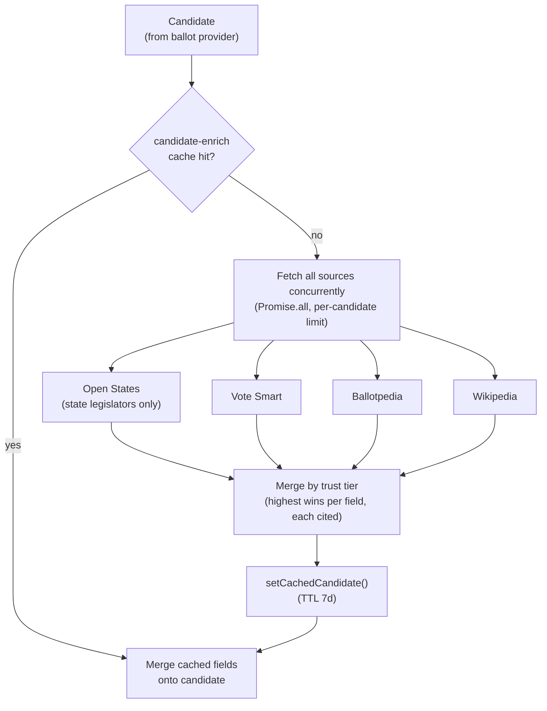

# Candidate Enrichment

The [measure cross-validation pattern](./measure-enrichment.md) also applies to
candidates. Democracy Works supplies the ballot roster and provider citations.
`enrichContest` in `civic.ts` fetches supplementary sources concurrently and merges
fields by trust tier. The highest-tier source holding a field wins and is cited.
When supplementary fields are merged onto the ballot, an existing provider field
and its citation survive unless the incoming field has a higher-trust citation.
Equal-tier ties retain the ballot provider value; empty values never replace it.
This rule also applies to cached candidate enrichment.
Candidate eligibility comes from the ballot provider, not enrichment.

## Source adapters

Adapters live in `packages/api/src/lib/candidate-sources/` (sharing the measure pipeline's `SourceTier`, citation shape, and fetch/HTML helpers via `candidate-sources/types.ts`):

| Source             | Adapter                | Contributes                                                     | Scope / gate                                                                                                  |
| ------------------ | ---------------------- | --------------------------------------------------------------- | ------------------------------------------------------------------------------------------------------------- |
| CA SOS Voter Guide | `ca-sos-voterguide.ts` | candidate statement (biography), email, phone, website, socials | **CA statewide offices only** — gates on `stateAbbrev === "CA"` + office→slug map; tier `state_sos`, official |
| Open States        | `open-states.ts`       | incumbent flag, photo, email, phone, website, socials           | **State legislators only** (gates on level/roles)                                                             |
| Vote Smart         | `votesmart.ts`         | biography, photo, office phone, website/email                   | resolve `candidateId` by name+state (`VOTE_SMART_API_KEY`)                                                    |
| Ballotpedia        | `ballotpedia.ts`       | biography, photo                                                | slugify name → article HTML; disambiguation guard                                                             |
| Wikipedia          | `wikipedia.ts`         | biography (intro extract), photo                                | no key; collision guard (must read as a political bio)                                                        |

## Key differences from the measure engine

- **No AI authoring of bios.** Every source that yields prose already returns a real, attributed `biography`. There is no grounded-AI fallback — when no source has a bio, the UI shows its sparse fallback rather than a guess from a bare name.
- **Collision defense.** A bare name ("John Smith") can resolve to a disambiguation page or an unrelated person. Ballotpedia and Wikipedia both guard against this — reject disambiguation pages, require the text to read like a political biography, and (Wikipedia) bias the title search with office + state. `candidateNameSimilarity()` (token Jaccard, accept at ≥0.7) matches a candidate across sources whose names vary by nickname/middle-name/suffix.
- **Cache-only, no DB rows.** Candidates are _not_ persisted to `candidate`/`contest`. The `civic_api_cache` row IS the storage, under endpoint `candidate-enrich`, keyed globally by `name + office + electionYear` plus optional disambiguators (`stateAbbrev`, `district`, `county`) so two same-name candidates in different places don't collide. TTL is **7 days** (bios change rarely; longer than the 24h voter-info TTL), so it also survives eviction of the voter-info response that triggered it.

Enriched fields are merged back onto the candidate, never clobbering existing ballot provider data with empties; per-candidate failures are swallowed so one bad lookup can't break the contest.

The California guide preserves every candidate entry on the supported statewide
office pages, including candidates explicitly marked as having no statement.
A missing statement stays absent; it does not remove the candidate or become
invented prose. This guide is not a complete certified ballot roster.

The base ballot route reads date-scoped candidate statements from the [official guide scraper](../apps/scraper/README.md#ballot-source-collection). It matches a unique full name and statewide office within a provider-selected California statewide contest. An entry without a statement leaves provider statements and citations unchanged. It does not invoke the request-time enrichment adapters when `includeEnrichment` is false.

A candidate page with no biography calls `civic.getCandidateBackground`. That uses this same cache key and `crossValidateCandidate` merge, including district and county when the route has them. It does not keep a second biography cache.

Biography loading waits for the California guide only for a matching statewide
ballot candidate. Other candidates load background immediately, even when the
unused guide query has never fetched. A supplied ballot biography still avoids
the background request.

## California research refresh failures

California research is scheduled by complete race demand, not by the full
candidate catalog. A successful address-matched provider ballot records only
the election, contest, district, office and candidate identities needed to match
an authoritative race. These demand records contain no address, address hash or
user identity. Cold and cached reads use the original provider observation;
reading a cached ballot cannot extend its 24-hour demand expiry. Statewide-only,
unknown, incomplete and ambiguous contest matches do not schedule research.
Matching includes every non-write-in opponent; the researcher then covers the
entire authoritative race, including qualified write-ins.

The shared demand store lives in
[`ballot-research-demand.ts`](../packages/api/src/lib/ballot-research-demand.ts).
The scheduled worker returns without source or model work when no active races
match. Demand expiry stops new work and does not withdraw existing publications.
Source freshness and independent review still control what readers can see.
The existing research browser still shows the collected catalog; it is not an
address-matched personal ballot. The separate address-based ballot flow remains
subject to provider launch readiness. A location such as San José alone does not
establish congressional, legislative or local districts. Restricting automatic
research does not change the mobile discovery interface.

Operators can persist explicitly requested districts using the scraper's
[`request` command](../apps/scraper/README.md#candidate-research-demand). These
records are labelled operator requests, not address-verified personal ballots.
They expire after the California election day and do not widen the automatic
worker to unrelated races.

Automatic California research refreshes the authoritative roster and the reviewed
San José source bundle before claiming races or generating new briefs. A typed
network outage or transient HTTP response stops that run without withdrawing
still-fresh published research. Its original source observations, approvals and
24-hour expiry remain unchanged; a failed refresh cannot extend them. The next
scheduled run must fetch the sources again before publishing new research.

Invalid or changed authority remains a hard failure. Retrieval validates each
territorial proof before requesting the next one, including approved telemetry
projections and strong raw-byte references. If a Clarity report changed and the
remaining bundle cannot be acquired, that unverified change also keeps the
invalidation behavior. A later timeout cannot hide a proof change already seen.

The acquisition classification lives in
[`california-source-availability.ts`](../apps/scraper/src/candidate-research/california-source-availability.ts).
The shared roster boundary is in
[`reconcile`](../apps/scraper/src/candidate-research/california.ts), and public
expiry remains enforced by
[`readCandidateRace`](../packages/api/src/lib/candidate-race-release.ts).

When a brief has no finance record, its public disclosure describes that absence
in the brief. Private collector gaps retain identity and retrieval diagnostics;
the compiler does not copy those assertions into an absent-finance disclosure.
Structured financial records and their supported coverage remain separate.

A first draft with financial records can still omit useful campaign research.
When eligible candidate passages exist but Priorities and Record are empty, the
worker uses its existing single correction attempt to reassess those passages.
This does not require invented claims: if the context still cannot establish
candidate research, an accurately sourced finance-only brief remains eligible
for independent review. The original draft and correction slot remain immutable.

An approved review belongs to its saved collection. If replacing one candidate's
draft creates a new collection, an unchanged opponent needs a review for that
collection too. The worker reuses the author and obtains a collection-scoped
review after the publication service identifies the binding conflict. Planned
successors are immutable, so an unknown attempt or rejected revision cannot be
retried by changing only the target collection. This behavior lives in
[`california-candidate-preparation.ts`](../apps/scraper/src/candidate-research/california-candidate-preparation.ts).
