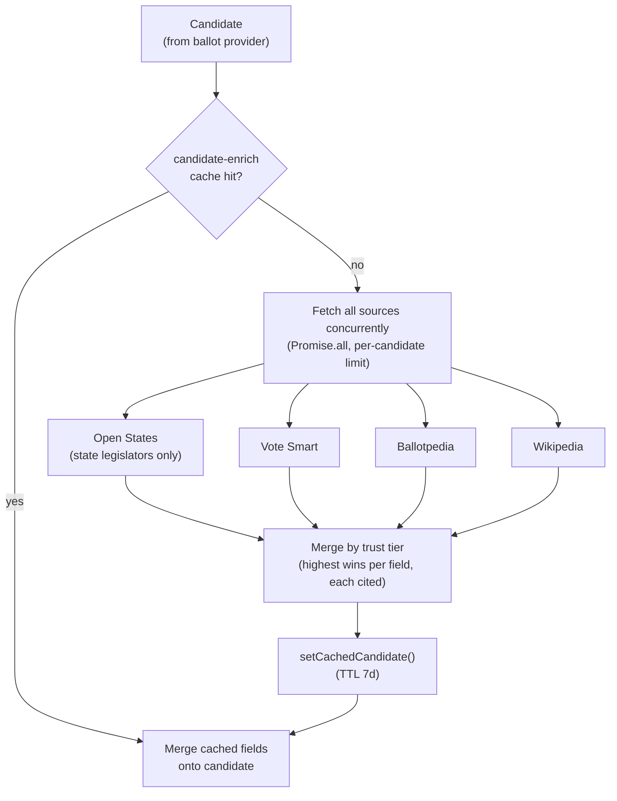

# Candidate Enrichment

The [measure cross-validation pattern](./measure-enrichment.md) also applies to
candidates. Democracy Works supplies the ballot roster and provider citations.
`enrichContest` in `civic.ts` fetches supplementary sources concurrently and merges
fields by trust tier. The highest-tier source holding a field wins and is cited.
When supplementary fields are merged onto the ballot, an existing provider field
and its citation survive unless the incoming field has a higher-trust citation.
Equal-tier ties retain the ballot provider value; empty values never replace it.
This rule also applies to cached candidate enrichment.
Candidate eligibility comes from the ballot provider, not enrichment.

## Source adapters

Adapters live in `packages/api/src/lib/candidate-sources/` (sharing the measure pipeline's `SourceTier`, citation shape, and fetch/HTML helpers via `candidate-sources/types.ts`):

| Source             | Adapter                | Contributes                                                     | Scope / gate                                                                                                  |
| ------------------ | ---------------------- | --------------------------------------------------------------- | ------------------------------------------------------------------------------------------------------------- |
| CA SOS Voter Guide | `ca-sos-voterguide.ts` | candidate statement (biography), email, phone, website, socials | **CA statewide offices only** — gates on `stateAbbrev === "CA"` + office→slug map; tier `state_sos`, official |
| Open States        | `open-states.ts`       | incumbent flag, photo, email, phone, website, socials           | **State legislators only** (gates on level/roles)                                                             |
| Vote Smart         | `votesmart.ts`         | biography, photo, office phone, website/email                   | resolve `candidateId` by name+state (`VOTE_SMART_API_KEY`)                                                    |
| Ballotpedia        | `ballotpedia.ts`       | biography, photo                                                | slugify name → article HTML; disambiguation guard                                                             |
| Wikipedia          | `wikipedia.ts`         | biography (intro extract), photo                                | no key; collision guard (must read as a political bio)                                                        |

## Key differences from the measure engine

- **No AI authoring of bios.** Every source that yields prose already returns a real, attributed `biography`. There is no grounded-AI fallback — when no source has a bio, the UI shows its sparse fallback rather than a guess from a bare name.
- **Collision defense.** A bare name ("John Smith") can resolve to a disambiguation page or an unrelated person. Ballotpedia and Wikipedia both guard against this — reject disambiguation pages, require the text to read like a political biography, and (Wikipedia) bias the title search with office + state. `candidateNameSimilarity()` (token Jaccard, accept at ≥0.7) matches a candidate across sources whose names vary by nickname/middle-name/suffix.
- **Cache-only, no DB rows.** Candidates are _not_ persisted to `candidate`/`contest`. The `civic_api_cache` row IS the storage, under endpoint `candidate-enrich`, keyed globally by `name + office + electionYear` plus optional disambiguators (`stateAbbrev`, `district`, `county`) so two same-name candidates in different places don't collide. TTL is **7 days** (bios change rarely; longer than the 24h voter-info TTL), so it also survives eviction of the voter-info response that triggered it.

Enriched fields are merged back onto the candidate, never clobbering existing ballot provider data with empties; per-candidate failures are swallowed so one bad lookup can't break the contest.

The California guide preserves every candidate entry on the supported statewide
office pages, including candidates explicitly marked as having no statement.
A missing statement stays absent; it does not remove the candidate or become
invented prose. This guide is not a complete certified ballot roster.

The base ballot route reads date-scoped candidate statements from the [official guide scraper](../apps/scraper/README.md#ballot-source-collection). It matches a unique full name and statewide office within a provider-selected California statewide contest. An entry without a statement leaves provider statements and citations unchanged. It does not invoke the request-time enrichment adapters when `includeEnrichment` is false.

A candidate page with no biography calls `civic.getCandidateBackground`. That uses this same cache key and `crossValidateCandidate` merge, including district and county when the route has them. It does not keep a second biography cache.

Biography loading waits for the California guide only for a matching statewide
ballot candidate. Other candidates load background immediately, even when the
unused guide query has never fetched. A supplied ballot biography still avoids
the background request.

## California research sources and chapters

The [California evidence collector](../apps/scraper/src/candidate-research/california-evidence.ts)
checks official office responsibilities separately from candidate claims.
Controller and Treasurer use their official functions pages. Governor, Attorney
General, Insurance Commissioner and Superintendent use the official voter guide's
institutional introduction, ending before the candidate statements. A missing-page
response or a page without the required office provision leaves a required
authority gap; a successful HTTP response alone does not qualify it.

Campaign publisher disclosures establish who publishes a page, not who made
every statement on it. The collector retains the surrounding footer context
and rejects quoted disclosures and third-party reporting. Word-internal
apostrophes in ordinary contractions do not turn a genuine disclosure into a
quotation. Candidate statements and same-origin campaign pages still retain
their own attribution and citations.

## California research refresh failures

California research is scheduled by complete race demand, not by the full
candidate catalog. A successful address-matched provider ballot records only
the election, contest, district, office and candidate identities needed to match
an authoritative race. These demand records contain no address, address hash or
user identity. Cold and cached reads use the original provider observation;
reading a cached ballot cannot extend its 24-hour demand expiry. Statewide-only,
unknown, incomplete and ambiguous contest matches do not schedule research.
Matching includes every non-write-in opponent; the researcher then covers the
entire authoritative race, including qualified write-ins.

The shared demand store lives in
[`ballot-research-demand.ts`](../packages/api/src/lib/ballot-research-demand.ts).
The scheduled worker returns without source or model work when no active races
match. Demand expiry stops new work and does not withdraw existing publications.
Source freshness and independent review still control what readers can see.
The existing research browser still shows the collected catalog; it is not an
address-matched personal ballot. The separate address-based ballot flow remains
subject to provider launch readiness. A location such as San José alone does not
establish congressional, legislative or local districts. Restricting automatic
research does not change the mobile discovery interface.

Operators can persist explicitly requested districts using the scraper's
[`request` command](../apps/scraper/README.md#candidate-research-demand). These
records are labelled operator requests, not address-verified personal ballots.
They expire after the California election day and do not widen the automatic
worker to unrelated races.

Automatic California research refreshes the authority for the selected races
before claiming work or generating new briefs. When every selected race matches
the unchanged SOS-certified roster, the worker checks fresh SOS text and PDF
observations. It preserves the combined snapshot and its historical San José
metadata without claiming a new local observation. Local or mixed selections
still refresh the reviewed San José source bundle. Changed statewide authority
still requires full snapshot reconciliation.

A typed network outage or transient HTTP response stops that run without
withdrawing still-fresh published research. Its original source observations,
approvals and 24-hour expiry remain unchanged. A failed refresh cannot extend
them. The next scheduled run must fetch the sources again before publishing.

Invalid or changed authority remains a hard failure. Retrieval validates each
territorial proof before requesting the next one, including approved telemetry
projections and strong raw-byte references. If a Clarity report changed and the
remaining bundle cannot be acquired, that unverified change also keeps the
invalidation behavior. A later timeout cannot hide a proof change already seen.

The acquisition classification lives in
[`california-source-availability.ts`](../apps/scraper/src/candidate-research/california-source-availability.ts).
The shared roster boundary is in
[`reconcile`](../apps/scraper/src/candidate-research/california.ts), and public
expiry remains enforced by
[`readCandidateRace`](../packages/api/src/lib/candidate-race-release.ts).

When a brief has no finance record, its public disclosure describes that absence
in the brief. Private collector gaps retain identity and retrieval diagnostics;
the compiler does not copy those assertions into an absent-finance disclosure.
Structured financial records and their supported coverage remain separate.

A first draft with financial records can still omit useful campaign research.
When eligible candidate passages exist but Priorities and Record are empty, the
worker uses its existing single correction attempt to reassess those passages.
This does not require invented claims: if the context still cannot establish
candidate research, an accurately sourced finance-only brief remains eligible
for independent review. The original draft and correction slot remain immutable.

An approved review belongs to its saved collection. If replacing one candidate's
draft creates a new collection, an unchanged opponent needs a review for that
collection too. The worker reuses the author and obtains a collection-scoped
review after the publication service identifies the binding conflict. It records
the immutable successor and model dispatch reservation together under the current
work lease. An expired lease records neither, so its replacement can continue.
Once reserved, a missing result blocks further reviews and cached approvals for
the same revision. Changing the target collection, review epoch or reviewer
configuration cannot bypass an unknown or rejected attempt. This behavior lives
in [`california-candidate-preparation.ts`](../apps/scraper/src/candidate-research/california-candidate-preparation.ts).

## Federal finance observations

Federal research resolves each selected House candidate against the official FEC
candidate master for the election cycle. Exact matching includes the office,
California district and election year. When a display name differs, the archived
SOS legal/display row or an official roster domain linked through a candidate's
Form 1 can establish the identity. The shared validator replays the same proof
before publication. A nickname or missing middle initial alone is insufficient.

The financial evidence also exposes the candidate-to-committee relationship to
readers and reviewers. The profile summary citation includes the verified
candidate heading and committee names and IDs. A separate exact candidate-master
excerpt ends at the principal committee ID, before every address field. These
citations remain visible when the model input drops optional surrounding context
to meet its byte limit. Retaining the full private archive alone does not supply
readable evidence to a bounded review.

Renewal compares the selected candidate's complete master row and replays the
unique identity proof. A change elsewhere in the statewide master does not
withdraw an unchanged candidate identity. This exception applies only when the
master supports financial identity citations alone. Changed candidate rows,
ambiguous identities, missing cited passages and nonfinancial uses retain the
ordinary source-change failure behavior. The new full archive keeps its actual
hash and observation time.

The finance collector in
[`california-finance.ts`](../apps/scraper/src/candidate-research/california-finance.ts)
shares bounded queries between the members of the current race. It retrieves
one processed House-report index for that race’s verified authorized committees
and one candidate-scoped independent-expenditure aggregate query. Unclaimed,
current or budget-excluded races do not enter the batch. A committee without a
financial summary also needs its exact filing index. A configured `FEC_API_KEY`
is preferred; the existing public demonstration key is subject to a shared
quota. A transient failure stops acquisition without extending an earlier
publication's original 24-hour expiry. The collector does not publish a replacement
summary-only record after a required component fails.

`finance.observation` records four separate outcomes. The campaign summary keeps
its reported coverage and explicitly supplied spending, cash, debt and individual
itemization amounts. Donor observations select up to ten positive non-memo
Schedule A transactions from the latest processed Form 3 for authorized
committees. Committees are ordered by ID, then transactions by receipt date
(descending) and transaction ID. The combined bound is ten. The source is a raw
FEC 8.5 electronic filing, checked against the processed report's committee and
coverage. Filing counts cite a compact index of every returned report with the
original query pagination and committee filters. This lets readers and reviewers
count the relevant committee's filings without loading the full report archive. Memo conduit rows, loans, refunds and transfers do not become donor
observations. Repeated contributor names remain separate transactions. A latest
filing with no selected transactions does not establish an empty donor history.

Independent expenditures use their own two-year election-cycle window. Complete
support and opposition totals require an exactly exhausted query for every
requested candidate ID. An empty candidate partition establishes zero only
inside that verified query scope. Periodic-report aggregates are separate from
campaign receipts and spending; notices are not added to them. The full exhausted
query is cited even when positive spender rows exist. One support row cannot
establish zero opposition or complete coverage. New filings can still be awaiting
FEC processing.

A filing-status observation can instead cite a committee's Form 99 statement
that it has not crossed the reporting threshold. The filing index records its
observed forms and counts. Such a statement supplies neither exact campaign
amounts nor zero donors. Summary and donor components remain unavailable in that
case, while independently retrieved outside spending remains usable.

For a committee without a usable financial summary, the collector reads the
official FEC electronic-filing index directly from `docquery.fec.gov`. It retains
the original HTML and checks the committee heading, complete table, filing links,
IDs, forms and dates before fetching the newest listed Form 99. Unknown forms,
financial reports, pagination and malformed rows stop this threshold-only path.
The statement's committee name and filed date must match the index. The citation
identifies the electronic-only scope, and a separate exhausted processed Form 3
query must contain no report for that committee. Neither source alone establishes
zero activity. Direct filings do not call or substitute a response for the API's
filing endpoint. Report and independent-expenditure queries keep their existing
scope, source-age and completeness checks.

The extracted index text contains only verified committee and filing fields. The
full HTML remains in its binary archive with the actual byte hash and observation
time. Replaying that archive must reproduce the extraction exactly. FEC's page
generation clock and layout do not change research attempt identity; an actual
filing change does. Existing rejected and unknown attempts remain terminal.

Whole source filings remain in the private archive. Public contribution evidence
contains the filing number, transaction ID, contributor name, entity type, date
and amount. Home addresses, employer and occupation fields are excluded from
those excerpts. Donor industry, lobbying status and influence are never inferred
from a contribution. The optional observation field has no parsing default, so
older approved revisions retain their original digest.

## Finance refreshes of published research

A targeted finance refresh preserves reviewed political narrative when its
nonfinancial evidence remains unchanged. The worker resolves the exact published
revision and its author and reviewer attestations. It fetches every retained
nonfinancial archive again. Candidate, primary, linked and gap-referenced source
content must remain unchanged before it collects current finance. Unused
third-party discovery pages may change without becoming evidence for a claim.
Their actual fresh archives remain in the dossier. Source identity, qualification
and membership stay fixed. Binary proofs remain strict. Nonbinary comparisons
use extracted text rather than volatile HTML bytes or historical redirect chains.

The author receives the qualified published narrative through the existing output
schema. Its actual first response must reproduce that narrative exactly. The
compiler regenerates financial records, evidence observations and coverage text
from the current dossier. A fresh independent reviewer assesses the complete new
profile. Historical approval cannot approve a new financial revision. The existing
single correction can repair reviewer findings, and rejected or unknown attempts
remain terminal for the same input. A correction receives another review only
when its compiled reader-facing content changes. New revision IDs, author IDs,
observation timestamps and correction metadata do not count as a repair. An
unchanged saved correction cannot use a cached approval or dispatch another
review. Compiler-owned coverage describes what the brief presents without
exposing collection-workflow commentary.

The same rejection rule applies before every initial, corrected and
collection-bound review, including cached approvals after a writer version
change. The API reads complete immutable candidate/race history and pairs each
review with its exact author, dossier, source set and policy. Reader-visible
content uses the shared `candidatePublicContentProjection`; new revision IDs,
writer metadata and observation clocks cannot erase an earlier rejection.
Genuinely changed claims, chapter placement, citation targets or validated source
sets may receive another independent review under the existing bounds. Claim IDs
and public evidence IDs are presentation graph labels. The projection normalizes
them by chapter/claim order and evidence order, including headline, promise and
citation references. It preserves prose, ordering, citation targets and financial
entity IDs. Exact private revision, dossier and attestation hashes remain intact.

A private dossier digest change alone cannot erase a rejection or unresolved
review when candidate, race, policy and source set stay the same. Private-only
qualification repairs can therefore remain conservatively blocked. The source-set
digest also contains source metadata; this comparison does not establish that
all possible source aliases are semantically equivalent. Historical invocation
pairing and current author/source/collection validation still require exact
dossier bindings.

History reads first select scoped artifact metadata, then enforce 512 rows and
8 MB of decoded payload before returning documents. Database statement and lock
timeouts fail closed. These limits bound results and waiting time, not physical
scan cost; the artifact table currently has no composite candidate-history index.
Malformed, orphaned, conflicting or incomplete history never means permission to
review. Legacy canonical author/review records are discovered without a new
semantic index or backfill.

Reviewer reservation rechecks the history proof under the same candidate history
lock used for canonical outcome writes. An unresolved earlier reviewer dispatch
blocks a replacement, even after lease loss. Late outcomes remain immutable audit
evidence. Conflicting results for one canonical key are retained separately and
block admission. Approval recording and publication recheck the same history
under the transaction lock. This fences new approvals and releases; it does not
retroactively withdraw an otherwise valid existing publication. These boundaries
live in `california-review-history.ts`, `california-roster-store.ts` and
`california-candidate-preparation.ts`.

The finance-refresh prompt has its own version. These versions also identify the
trusted compiler's output contract. Cache keys include the current
semantic dossier and retained narrative, but exclude historical publication run
IDs. Repeating the same refresh cannot obtain a new attempt merely because the
previous publication changed those IDs. Ordinary research still discovers new
campaign material. The targeted operator command is documented in the
[scraper CLI guide](../apps/scraper/README.md#candidate-research-demand).

A finance-only restart can reuse full official FEC query responses from its latest
saved acquisition dossier for up to 12 hours. These source checks apply when
preparation is pending, blocked or complete. The political narrative still comes
from the exact published revision. Cached queries retain their original text,
hashes and observation times. Fresh identity resolution determines the exact
requested URL, so a changed candidate or committee scope misses the cache.
Derived rows, incomplete responses, invalid hashes and stale observations are not
reused. The ordinary publication expiry still starts at the oldest actual source
observation. Reusing a query does not adopt a rejected model output or clear a
review failure.

If a release expires before a finance-only restart, a private baseline reader can
recover its reviewed narrative. It selects the latest release before checking
revocation, current policy, roster membership and the exact approved revisions.
An expired unrevoked release supplies historical narrative only. It remains
unavailable to public readers until fresh evidence and new independent reviews
produce a current release. A newer revoked release cannot revive an older
approval. Retained nonfinancial evidence still requires fresh qualification, and
the twelve-hour query cache limit remains unchanged.

## Fresh narrative-only research

An explicit bounded narrative-only reconciliation acquires current nonfinancial
evidence without reusing old dossiers, financial query caches or reviewed prose.
It skips all finance-specific identity and source acquisition. The dossier records
null finance and an honest gap with no checked financial sources. The existing
public compiler describes financial amounts as unavailable, never zero.

This scope preserves current eligible race releases and requires substantive
candidate Record or Priorities with the ordinary author, independent review,
source freshness and whole-race gates. It does not change policy or clear prior
model failures. The [scraper CLI guide](../apps/scraper/README.md#candidate-research-demand)
describes its operator flags.

### Campaign acquisition capability

The California Governor adapter can acquire a successful thin campaign module shell through a separately hosted network-none Chromium capability. All browser assets still use the researcher's pinned public GET transport and shared limits. A typed private archive binds actual response bytes, rendered visible DOM and extracted evidence; it does not replace ordinary HTTP source provenance. Renderer absence fails closed with a source gap. [Host setup and the normal data flow](../deploy/big-mac/campaign-renderer/README.md) explain deployment, isolation, cleanup and archive replay.

A distinct qualified-party discovery proof can bind an otherwise missing current SOS campaign website to the exact current candidate. It preserves the missing contact field and verifies official party registration, the election/office/full-name campaign link, actual redirects and the campaign's legal publisher. This proof establishes source ownership, not personal speech attribution or a state endorsement.
