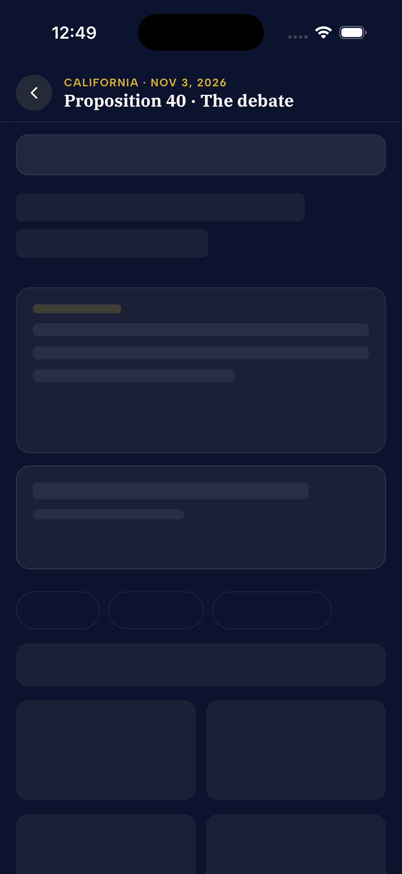
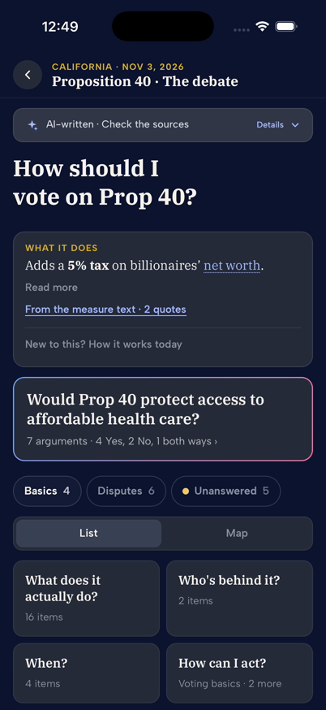
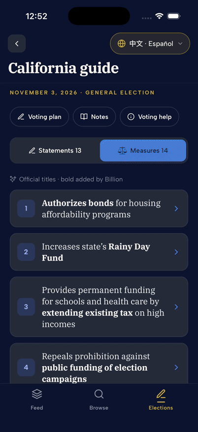

# Ballot measure loading transition

Captured on October 17, 2026 in the Expo development build on an isolated iPhone 17 Pro simulator running iOS 26.5. The route was opened through Elections → California guide → Measures → Proposition 40. The guide uses the live public API; development builds can use the checked-in debate pilot when a published graph is unavailable. This verifies rendering and navigation, not publication status or editorial accuracy.

The header stays visible while the WebView mounts behind the native skeleton. The body is revealed after stylesheet loading, font layout, and a painted frame. This is an atomic reader reveal, not streaming per-card data. Placeholders reserve typical summary and featured-question heights; content-dependent heights can still differ.

The recording includes iOS's rounded push transition. A 60 fps corner-pixel comparison found white corners in 10 of 104 frames before setting the navigation container background; the final capture had none in 87 frames. The GIF is a 30 fps derivative of that capture. Back navigation returned to the guide.

An actual-engine browser harness separately exercised an eight-second stylesheet delay and an immediate stylesheet failure. The delayed case revealed stable system typography after about 2.1 seconds, and the stale mount never signaled readiness. Unit coverage checks stylesheet/font/paint sequencing, cancellation, and never-settling stylesheet and font promises.

Android runtime and VoiceOver focus transfer were not tested. Native accessibility inspection showed Back, the measure identity, and the busy loading indicator while the WebView was covered.
