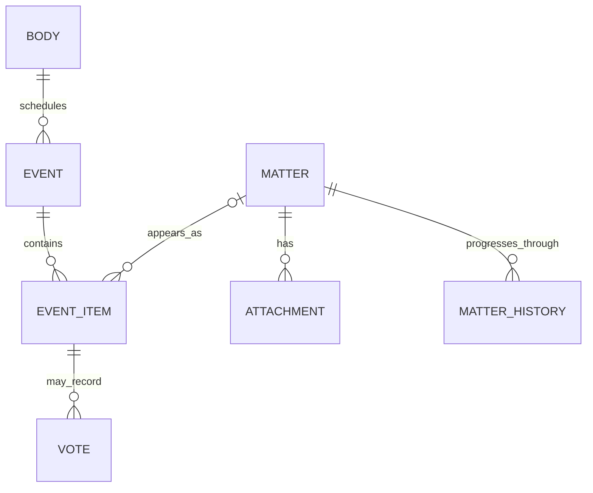
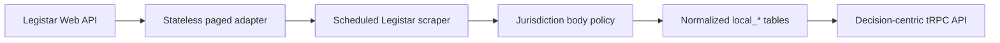

# Local government decisions and Legistar

> Jurisdictions: City of San José and City of Santa Clara
> Tracking issue: [#515](https://github.com/billion-app/billion/issues/515)

Legistar is a records-management system, not a feed of interchangeable “local
bills.” A proposal can appear before several bodies and at several meetings,
while the agenda item, attachments, minutes, and vote endpoint each describe a
different part of its lifecycle. Billion therefore treats Legistar as a source
adapter behind a source-neutral local-government model.

## Source model and identity

- A **Body** is a council, committee, board, commission, or hearing body.
- An **Event** is a meeting and owns its time, location, agenda, minutes, and
  video links.
- An **EventItem** is one occurrence on a meeting agenda. Meeting-specific
  action, tally, mover, seconder, and votes belong here.
- A **Matter** is the proposal or file. The same Matter can appear at multiple
  meetings, so it is the canonical decision identity but not the occurrence.
- An **Attachment** is an official document or link associated with a Matter.

The normalized model separates `local_decision` (one source Matter) from
`local_meeting_item` (one EventItem occurrence). This supports one decision
card with a truthful multi-meeting timeline. Similar titles never merge records.

## Implemented architecture

The transport in `packages/api/src/integrations/legistar.ts` performs bounded,
paged source reads and has no cache, mock fallback, or database side effects.
The `legistar` and `legistar-santaclara` scrapers use separate jurisdiction
contexts and body policies. Each scraper:

1. discovers meetings in a bounded past/future window;
2. restricts them to its jurisdiction's explicit body policy;
3. fetches complete EventItems, Matters, attachments, histories, and votes;
4. classifies boilerplate, topics, geography, and document policy;
5. extracts native PDF text by page and hashes official documents;
6. idempotently upserts records and soft-deletes disappeared meetings,
   occurrences, and attachments;
7. records each run, its window, counters, failure, and completion state.

The default window is 45 days back and 120 days forward. Operators can tune the
window, item cap, document-size ceiling, and extraction through `LEGISTAR_*`
variables. A capped run never treats unvisited meetings as deleted.

### Storage

The old unused `legistar_*` cache tables are replaced by:

| Table                     | Purpose                                       |
| ------------------------- | --------------------------------------------- |
| `local_jurisdiction`      | Adapter and public portal identity            |
| `local_body`              | Source bodies plus inclusion/relevance policy |
| `local_decision`          | Canonical Matter, topic, dates, and geography |
| `local_meeting`           | Event schedule and official artifact links    |
| `local_meeting_item`      | Matter occurrence and outcome fields          |
| `local_decision_document` | Attachment policy, hash, and extracted text   |
| `local_decision_history`  | Structured Matter history when published      |
| `local_decision_vote`     | Named structured votes when published         |
| `local_ingestion_run`     | Window, status, counters, and errors          |

All foreign keys are indexed. Raw payloads and source modification times are
retained. Source removals are recorded rather than hard-deleted. Row-level
security is enabled on every new public-schema table without anon or
authenticated policies; access is through the server API.

### Read API

- `legistar.listDecisions` returns canonical decisions with an upcoming or recent
  meeting, text search, topic, district relevance, and pagination. It chooses one
  occurrence per decision before pagination. Upcoming lists use the earliest
  matching meeting, and recent lists use the latest. UUID ordering breaks ties.
- `legistar.byIds` hydrates up to 200 saved decision UUIDs. It uses the latest
  occurrence, including future meetings. Callers restore saved-item order.
- `legistar.listJurisdictions` returns supported active cities with a live
  decision occurrence at an included body. A configured city with no such
  records is absent.
- `legistar.getDecision` returns canonical detail, the full timeline, documents,
  history, votes, public-comment count, participation guidance, and a validated
  brief or `null`.
- `legistar.listBodies` returns included active bodies in editorial priority order.
- `legistar.getIngestionHealth` returns the latest run and active-decision count.

Old wire-format endpoints remain temporarily for dormant prototype callers.
They are deprecated, read-only source calls and are not the new UI contract.

### Presentation and language policy

Local decisions retain their own API and identity rather than joining the mixed
article feed. The Home module uses the saved address. Browse permits city
exploration without changing that address. City discovery uses
`legistar.listJurisdictions`, so support requires ingested records as well as a
reviewed policy.

UI labels are translated. Official titles, document text, and quoted evidence
stay in their source language. English source titles are identified as original
text in Spanish and Chinese interfaces. Generated briefs are English and carry
a language notice. Billion's explanations remain separate from the official
record, with document and page references beside each claim.

### Follows and notifications

Saved decision UUIDs use the existing account-free saved-content store.
`notifications.sync` resolves those UUIDs and creates `DeviceFollow` records
with `contentType` set to `local_decision`. Each follow stores a snapshot of
occurrence IDs, meeting dates, cancellation flags, and structured outcomes.
An outcome contains action, passed flag, and tally.

The initial snapshot establishes a baseline without sending archive alerts.
Later comparisons notify for newly scheduled or rescheduled upcoming meetings,
upcoming cancellations, and changed structured outcomes. A newly discovered
outcome notifies only when its meeting began at or after the follow began.
Older backfilled meetings remain silent. Title edits, document churn, and source
timestamps alone do not trigger notifications. Missing outcomes remain unknown.

The worker locks follows and commits snapshot updates with outbox inserts.
Alerts reuse the existing `follow` kind, quiet hours, delivery receipts, and
opt-out cancellation. Saving a decision does not require push permission.
Delivery still requires a registered push token and enabled follow alerts.

## San José first-release policy

Live discovery in August 2026 confirmed unauthenticated reads and a large,
mixed body list. EventItems contain both actual Matters and procedural rows.
Attachments include staff memoranda, ordinances, resolutions, presentations,
supplements, and public letters. Sampled completed meetings often had sparse
structured histories and votes, so missing structured data means “unknown,”
never “no action.”

### Included bodies

The release uses three editorial tiers:

1. City Council and the six standing policy committees.
2. High-impact resident-facing bodies, including Planning, Housing, Historic
   Landmarks, Appeals, Airport, Bicycle/Pedestrian, Climate, and oversight.
3. Community and quality-of-life bodies, including Arts, Civil Service,
   Senior Citizens, Youth, Privacy, Smart City, and Small Business.

Closed session, notice-only, miscellaneous, internal administrative, and
employee-benefit bodies are excluded. Exact IDs live in
`apps/scraper/src/scrapers/legistar-policy.ts`. The boundary favors decisions
affecting residents’ money, housing, mobility, safety, services, rights, land
use, or participation.

## City of Santa Clara policy

The Legistar client `santaclara` identifies the **City of Santa Clara**. Its
public portal is `https://santaclara.legistar.com`. It does not represent Santa
Clara County. County decisions remain deferred because the county uses a
separate records system and needs its own adapter and policy.

`SANTA_CLARA_BODY_POLICY` in `apps/scraper/src/scrapers/legistar-policy.ts`
contains the city's independent allowlist. City Council and Stadium Authority
have tier 1 priority. Planning, Housing, Library, Historical and Landmarks,
Parks and Recreation, Bicycle and Pedestrian, and Development Review have tier 2
priority. Cultural, Senior Advisory, and Youth bodies have tier 3 priority.
Unlisted bodies, including closed-session, video-only, deferred, and obsolete
entries, are excluded. San José IDs never determine Santa Clara inclusion.

## Shared source policy

### Geography

Scope is conservative. Explicit district references produce district scope;
explicit addresses produce place scope; only explicit citywide language
produces citywide scope. An absent district remains `unknown`. District items
may rank above citywide items, but citywide decisions should not be hidden.

### Documents and OCR

A sampled 39-page memorandum contained about 127,000 characters of embedded
text and a 14-page presentation about 17,000. A sampled one-page public letter
had no embedded text. Therefore:

- official PDFs use native extraction first;
- fewer than 80 extracted characters per page marks `ocr_required`;
- public-comment documents are link-only and never enter OCR or indexing;
- OCR publication should require at least 98% sampled character accuracy (or
  equivalent high-confidence validation);
- OCR must not be the sole evidence for votes, money, deadlines, or addresses.

Native extraction stores `extractedPages` in original PDF order, including empty
pages. Citation page numbers are one-based indexes into that array. The scraper
hashes the PDF bytes before the PDF parser can transfer the buffer. Cached
native text without pages, and known empty-buffer hashes, require re-extraction.
The current implementation detects and records OCR work. An OCR worker remains
follow-up work.

## Public-comment privacy decision

Public-comment letters matter because they show resident engagement and form
part of the official record. They can also expose names, signatures, home
addresses, email addresses, phone numbers, medical circumstances, immigration
details, or other information submitted for a specific civic purpose.

For the first release Billion shows the official link and aggregate document
count, but does not download, OCR, index, quote, summarize, classify, or build
profiles from individual letters. Public availability is not the same as
consent to make scattered personal details newly searchable or send them to an
AI provider. Aggregate sentiment could be reconsidered only with redaction,
minimum-group thresholds, provenance, and a dedicated privacy review.

## Evidence, outcomes, and participation

Fact precedence is field-specific:

1. structured action/vote data for that EventItem;
2. approved official minutes;
3. amended agenda, agenda, or staff memorandum;
4. other official attachments and meeting pages;
5. official video/transcript as context only.

Missing votes and history remain unknown. AI-authored explanations must not
infer a vote from attendance or sentiment. Official record links use the
source's meeting URL. API Matter IDs are not assumed to be public portal IDs.

Participation guidance links to the relevant city's official portal and tells
readers to check the meeting agenda. It does not invent participation methods
or deadlines. Meeting-specific instruction extraction remains follow-up work.

### Cited briefs

`LocalDecision.brief` stores an optional English brief. Only native extracted,
active official documents with `extract_text` policy and content hashes qualify.
Public comments never qualify. Generation supplies at most four documents and
24,000 characters of page text, then requests one to five claims with citations.
After exact citation validation, a separate model call checks each claim using
only its quoted evidence. All claims must receive one supporting verdict; any
rejection, missing verdict, or duplicate index rejects the entire brief. Each
eligible decision permits at most two model calls with no retries or provider
fallback. Decisions without eligible text make no model calls.

`validateLocalDecisionBrief` checks every cited document, page, and quote.
Whitespace-normalized quotes must occur on the cited original page. The brief's
hash map must match the complete set of eligible documents. Its `sourceContext`
must match the decision title, status, source update time, and occurrence dates
and outcomes. Document changes or relevant record changes make the brief stale.

`getDecision` returns `null` for stale or invalid briefs. Reads do not regenerate
or overwrite them. The official record remains available. Generation is an
explicit bounded command described in the [scraper CLI guide](../apps/scraper/README.md#prepare-local-decision-briefs).

Quote matching proves where text came from. It does not prove that a claim
follows from that text. Publication review must compare each generated claim
with its cited page, including proposal versus adopted-action wording. The
validator does not replace this review.

### Manually reviewed explanation pilot

Explanations are a manually reviewed pilot. The supervisor ingests official records but does not schedule generation. Operators generate bounded samples in a review database, check every claim and quoted excerpt against the original PDF, and publish only reviewed text against matching production source hashes and context. The model evidence check is an additional filter, not an editorial approval. Minor source changes can hide a brief until an operator regenerates and reviews it; the official record remains readable.

## Operations and failure behavior

- Production never substitutes synthetic records for failed source reads.
- Pagination and retries are bounded.
- Every run records its complete query window and result.
- Last-known records survive transient failures.
- Retrieval, extraction, and deletion are separate states.
- Public reads exclude soft-deleted records.
- Fixtures and policy tests run offline.

The supervisor defines separate daily jobs, `legistar-daily` and
`legistar-santaclara-daily`. Deployment must install the merged scraper image
and supervisor configuration before the second source runs in production.
See the [scraper CLI guide](../apps/scraper/README.md#refresh-local-decisions)
for bounded refresh and deployment steps.

## Decisions and remaining work

Decisions made here:

- canonical card = Matter; each hearing/reading = timeline occurrence;
- explicit three-tier body allowlist based on resident impact;
- native extraction first, with deterministic OCR and acceptance gates;
- public letters remain links/counts but are excluded from AI/text processing;
- conservative geography with `unknown` as a valid state;
- normalized source-neutral schema instead of unused cache tables;
- no mock fallback and no uncited AI summaries.

Remaining product-quality work:

- approved-minutes extraction;
- OCR worker and measured validation set;
- agenda-specific participation extraction;
- official GIS resolution for addresses and user districts;
- amended-recommendation comparison;
- measured “outcome pending” thresholds;
- a separate Santa Clara County adapter and reviewed source policy.
