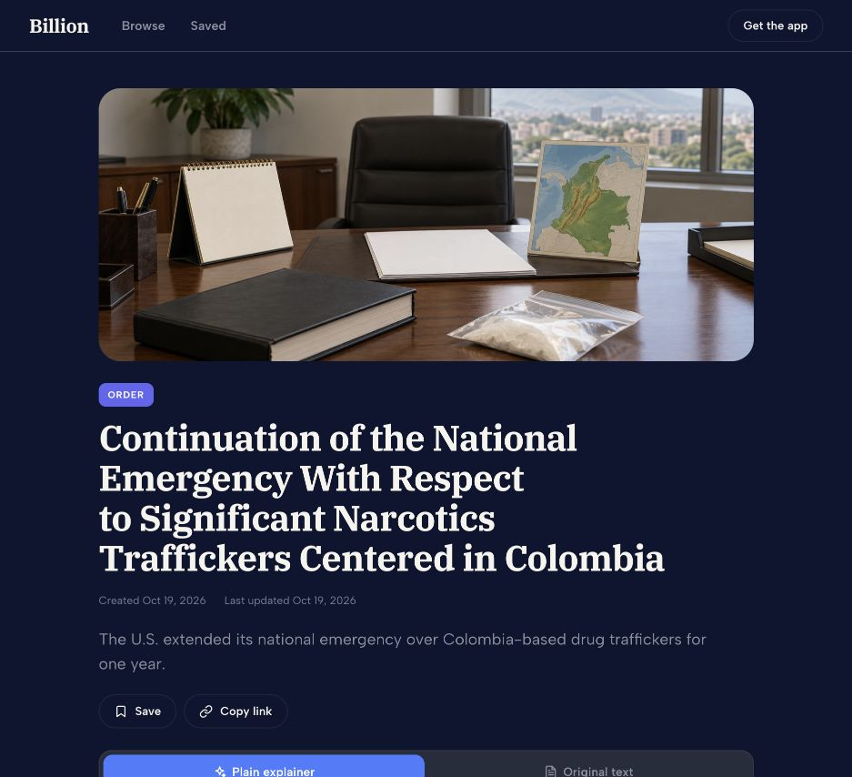
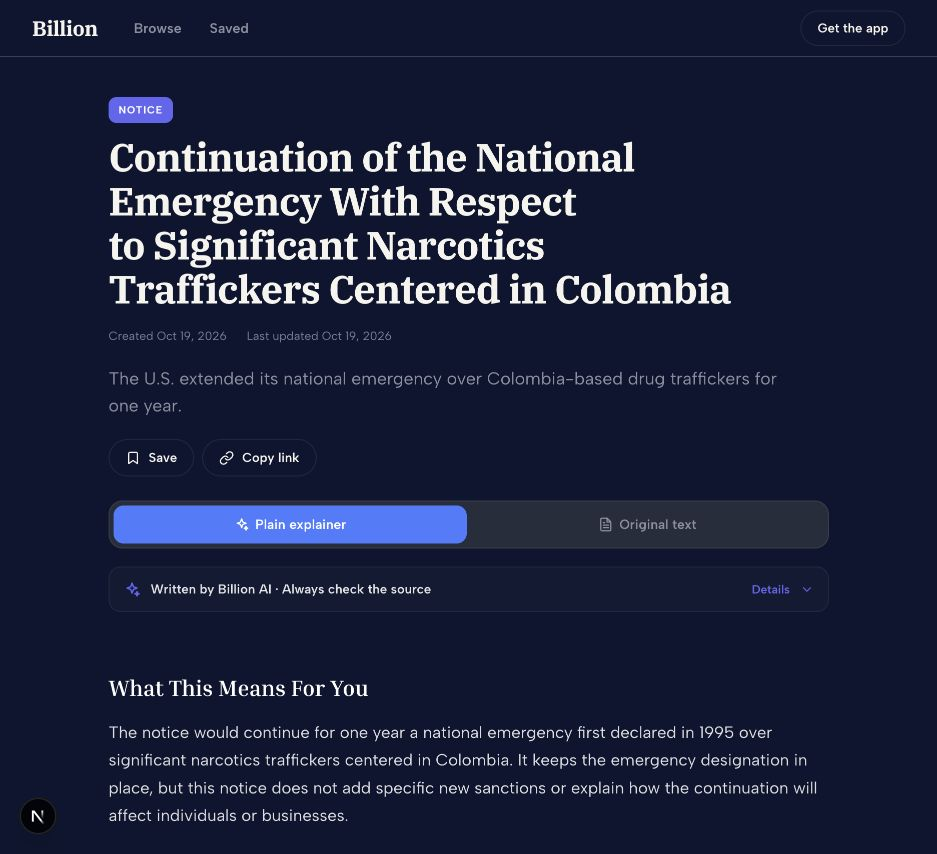
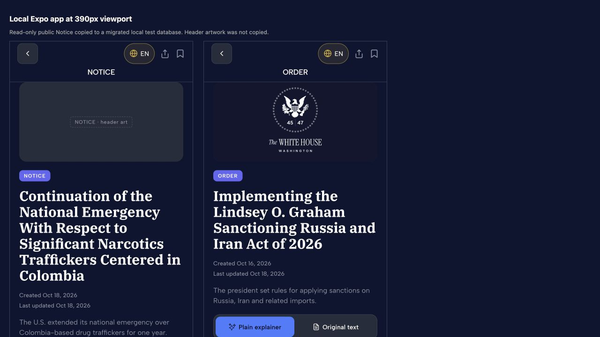
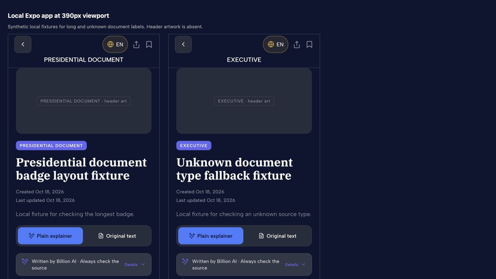

# Presidential article badge verification

The production reader labeled a Federal Register Notice as ORDER. The database
stored its source type correctly, but API projections dropped it and the shared
executive category supplied the same label for every presidential record.

The fix carries `governmentContentType` through the existing content API. Mobile,
web, and shared cards use that source type for their badge. Missing or unknown
types use EXECUTIVE. Routing, notification subscriptions, and delivery remain
unchanged.

## Runtime evidence

The before screenshot shows the live web reader. The after screenshots show
local development builds on branch `codex/presidential-article-badges`. The public
Notice and Executive Order records were copied read-only into a migrated local
test database. Header-image storage records were not copied. No production data
or notification preferences were changed.

The following screenshot embeds the running Expo web app in two 390px frames.
It verifies the mobile components at phone width. It is not an iOS device test.

Synthetic local records exercise the long Presidential Document label and the
unknown-type fallback at the same width.

## Checks

The API regression uses a separate local database ending in `_test`. Its ten
procedure checks failed before the patch because the source type was absent.
They pass after the patch across six source document kinds.

The badge regression failed before the patch with `'ORDER' !== 'NOTICE'`.
It passes after the patch. Workspace lint, typecheck, tests, and formatting pass.
Lint retains one existing image warning in the cinematic landing page.

An independent Astra review found no actionable correctness or labeling issues.
The requested Claude design consultation returned no advice because its session
limit was reached.
